<!-- Generated by scripts/build.py from scripts/README.template.md and the data at the top of build.py. Edit those, not this file. -->

<picture><source media="(max-width: 640px)" srcset="assets/hero-m.svg"></picture>

  <a href="https://kipung.github.io"><b>Website</b></a> &nbsp;·&nbsp;
  <a href="https://kipung.github.io/files/kip-park-cv.pdf"><b>CV</b></a> &nbsp;·&nbsp;
  <a href="https://www.linkedin.com/in/kip-park"><b>LinkedIn</b></a> &nbsp;·&nbsp;
  <a href="mailto:nankipung@gmail.com"><b>Email</b></a> &nbsp;·&nbsp;
  <a href="#publications--talks"><b>Publications</b></a>

**Now**

- Building the CAIMLL lab's fine-tuning pipeline
- Leading a subliminal-learning study (under review)
- Studying rainfall estimation for flood prediction

## Featured

<table>
  <tr>
    <td width="50%"></td>
    <td width="50%"><a href="https://github.com/kipung/terminal-browser">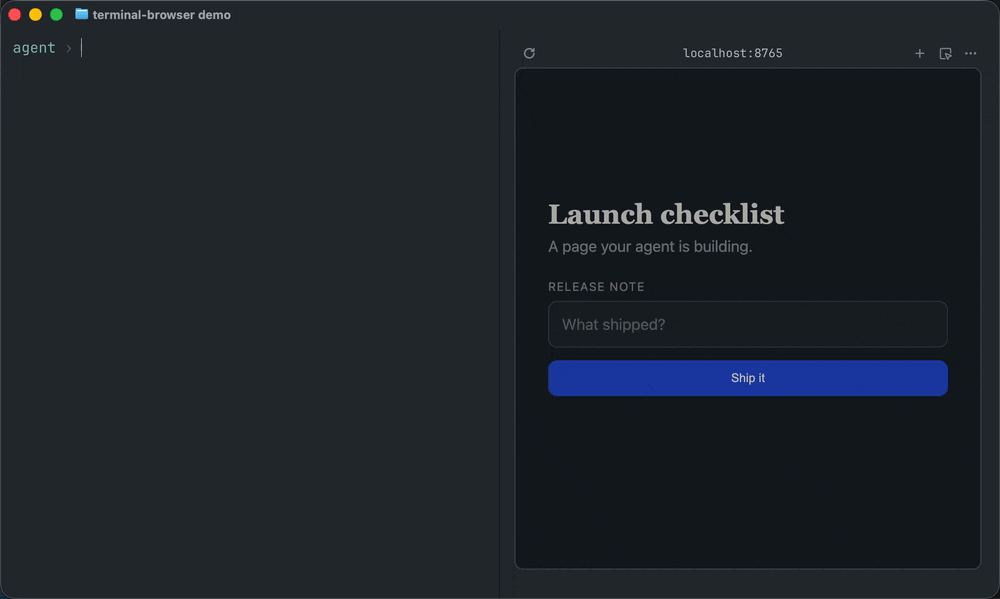</a></td>
  </tr>
  <tr>
    <td valign="top"><b>Living Kanto</b> A persistent world where 100 residents, each run by a local language model, travel, work, talk and pursue their own ambitions. local LLMs · agents · persistent world state · <a href="https://github.com/kipung/living-kanto">github.com/kipung/living-kanto →</a></td>
    <td valign="top"><b>Terminal Browser</b> Claude Code drives a live page in a split beside your terminal. Ghostty · kitty · WezTerm · tmux · <a href="https://github.com/kipung/terminal-browser">github.com/kipung/terminal-browser →</a></td>
  </tr>
</table>

<picture><source media="(max-width: 640px)" srcset="assets/feat-finetune-m.svg"></picture>
<a href="https://github.com/kipung/WeHateOwls"><picture><source media="(max-width: 640px)" srcset="assets/feat-subliminal-m.svg"></picture></a>
<a href="https://aisel.aisnet.org/amcis2025/intelfuture/intelfuture/27/"><picture><source media="(max-width: 640px)" srcset="assets/feat-geoai-m.svg"></picture></a>

### More projects

<a href="https://github.com/kipung/degree_planning_guide"><picture><source media="(max-width: 640px)" srcset="assets/proj-degree-m.svg"></picture></a>
<a href="https://github.com/kipung/terminal-browser"><picture><source media="(max-width: 640px)" srcset="assets/proj-browser-m.svg"></picture></a>

<picture><source media="(max-width: 640px)" srcset="assets/proj-hydro-m.svg"></picture>
<picture><source media="(max-width: 640px)" srcset="assets/proj-lensing-m.svg"></picture>

<b>7 more projects</b>

<a href="https://github.com/kipung/SET_PROJECT_3"><picture><source media="(max-width: 640px)" srcset="assets/proj-acm-m.svg"></picture></a>
<a href="https://github.com/kipung/tracr_to_transformer_lens_generalize"><picture><source media="(max-width: 640px)" srcset="assets/proj-tracr-m.svg"></picture></a>

<a href="https://github.com/kipung/ffn_relu_vs_geglu_mnist"><picture><source media="(max-width: 640px)" srcset="assets/proj-geglu-m.svg"></picture></a>
<picture><source media="(max-width: 640px)" srcset="assets/proj-voice-m.svg"></picture>

<a href="https://github.com/kipung/BAY-min_personal_tutor"><picture><source media="(max-width: 640px)" srcset="assets/proj-baymin-m.svg"></picture></a>
<a href="https://github.com/kipung/campusmate"><picture><source media="(max-width: 640px)" srcset="assets/proj-campusmate-m.svg"></picture></a>

<a href="https://github.com/kipung/functiongemma-hackathon"><picture><source media="(max-width: 640px)" srcset="assets/proj-hackathon-m.svg"></picture></a>

## Photos

<b>Conferences, competitions, robots and hardware</b>

<picture><source media="(max-width: 640px)" srcset="assets/photos-room-m.svg"></picture>

<picture><source media="(max-width: 640px)" srcset="assets/photos-bench-m.svg"></picture>

## Experience

<picture><source media="(max-width: 640px)" srcset="assets/timeline-m.svg"></picture>

## Publications & talks

- **Corso, A., Asariah, J. S., Park, K., Corso, N. A., & Lee, E. (2025).** *A DSR Approach for Geospatial AI: Prediction of Drug Overdoses.* AMCIS 2025, Montréal. [Paper](https://aisel.aisnet.org/amcis2025/intelfuture/intelfuture/27/)
- **Park, K., Bergquist, G., Lee, P., & Sanders, B.** *Replicating Subliminal Learning in LLMs via Distillation and LoRA Fine-Tuning.* Under review, *Aletheia: The Alpha Chi Journal of Undergraduate Scholarship*.
- **SCCUR 2026**, San Diego State (Nov. 21): *Towards Modeling Runoff and Flood Prediction over Unreliable Precipitation Gauges* (first author) and *Separate or Unified Fine-Tuning? A Systematic Comparison of Training Strategies for Multi-Document Domain Applications* (second author).
- **KSEA SWRC 2026**, CSU Fullerton: *Subliminal Learning in Large Language Models*; *A Design Science Research Approach for Geospatial AI*.
- **AMCIS 2025**, Montréal: paper presentation.
- 🏆 **3rd place** (online division), Cactus × Google DeepMind FunctionGemma Hackathon.

## Toolbox

<b>ML</b> PyTorch · JAX / Haiku · TransformerLens · Unsloth · LangChain &nbsp;·&nbsp; <b>Methods</b> LoRA / QLoRA · sparse autoencoders · evaluation · synthetic data &nbsp;·&nbsp; <b>Inference</b> Ollama · vLLM · GGUF &nbsp;·&nbsp; <b>Data</b> Neo4j · PostgreSQL · FAISS

Riverside, CA · Interests: LLM architectures, vision-language-action models, physical AI
