<!-- Generated by scripts/build.py from scripts/README.template.md and the data at the top of build.py. Edit those, not this file. -->

<picture><source media="(max-width: 640px) and (prefers-color-scheme: dark)" srcset="assets/hero-m-dark.svg"><source media="(max-width: 640px)" srcset="assets/hero-m-light.svg"><source media="(prefers-color-scheme: dark)" srcset="assets/hero-dark.svg"></picture>

  <a href="https://kipung.github.io"><b>Website</b></a> &nbsp;·&nbsp;
  <a href="https://kipung.github.io/files/kip-park-cv.pdf"><b>CV</b></a> &nbsp;·&nbsp;
  <a href="https://www.linkedin.com/in/kip-park"><b>LinkedIn</b></a> &nbsp;·&nbsp;
  <a href="mailto:nankipung@gmail.com"><b>Email</b></a> &nbsp;·&nbsp;
  <a href="https://aisel.aisnet.org/amcis2025/intelfuture/intelfuture/27/"><b>AMCIS 2025 paper</b></a> &nbsp;·&nbsp;
  <a href="#publications--talks"><b>Publications</b></a>

**Now:** building the CAIMLL lab's fine-tuning pipeline, leading a subliminal-learning study through revision, and studying rainfall estimation for flood prediction.

## Figures

<a href="https://github.com/kipung/living-kanto"><picture><source media="(max-width: 640px) and (prefers-color-scheme: dark)" srcset="assets/fig-kanto-m-dark.svg"><source media="(max-width: 640px)" srcset="assets/fig-kanto-m-light.svg"><source media="(prefers-color-scheme: dark)" srcset="assets/fig-kanto-dark.svg">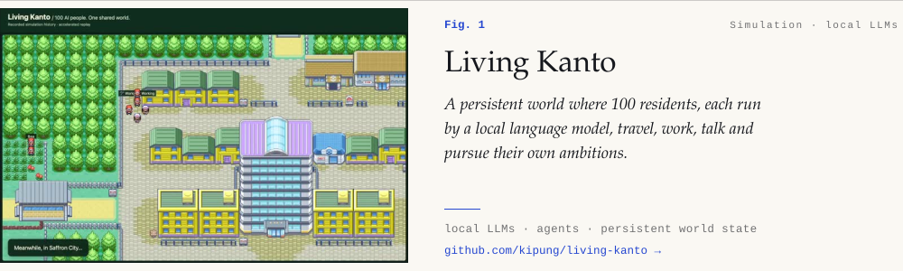</picture></a>
<picture><source media="(max-width: 640px) and (prefers-color-scheme: dark)" srcset="assets/fig-finetune-m-dark.svg"><source media="(max-width: 640px)" srcset="assets/fig-finetune-m-light.svg"><source media="(prefers-color-scheme: dark)" srcset="assets/fig-finetune-dark.svg">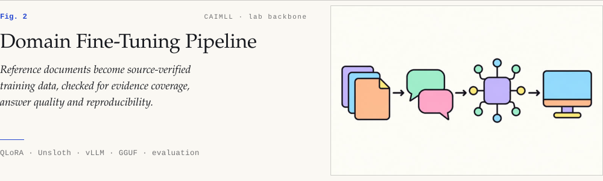</picture>
<a href="https://github.com/kipung/WeHateOwls"><picture><source media="(max-width: 640px) and (prefers-color-scheme: dark)" srcset="assets/fig-subliminal-m-dark.svg"><source media="(max-width: 640px)" srcset="assets/fig-subliminal-m-light.svg"><source media="(prefers-color-scheme: dark)" srcset="assets/fig-subliminal-dark.svg">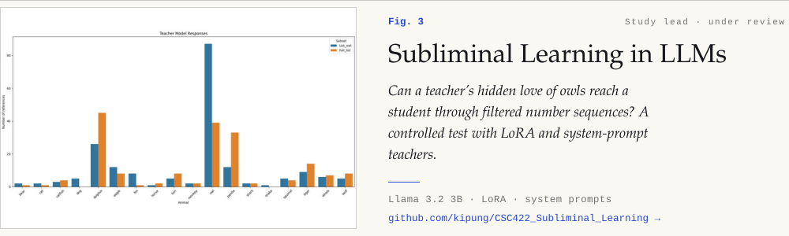</picture></a>
<a href="https://aisel.aisnet.org/amcis2025/intelfuture/intelfuture/27/"><picture><source media="(max-width: 640px) and (prefers-color-scheme: dark)" srcset="assets/fig-geoai-m-dark.svg"><source media="(max-width: 640px)" srcset="assets/fig-geoai-m-light.svg"><source media="(prefers-color-scheme: dark)" srcset="assets/fig-geoai-dark.svg">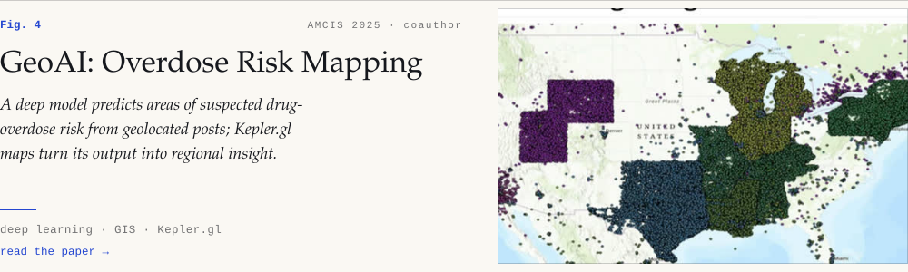</picture></a>

### More projects

<a href="https://github.com/kipung/degree_planning_guide"><picture><source media="(max-width: 640px) and (prefers-color-scheme: dark)" srcset="assets/mini-degree-m-dark.svg"><source media="(max-width: 640px)" srcset="assets/mini-degree-m-light.svg"><source media="(prefers-color-scheme: dark)" srcset="assets/mini-degree-dark.svg">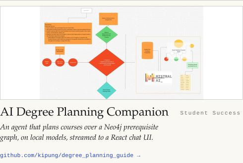</picture></a>
<a href="https://github.com/kipung/terminal-browser"><picture><source media="(max-width: 640px) and (prefers-color-scheme: dark)" srcset="assets/mini-browser-m-dark.svg"><source media="(max-width: 640px)" srcset="assets/mini-browser-m-light.svg"><source media="(prefers-color-scheme: dark)" srcset="assets/mini-browser-dark.svg">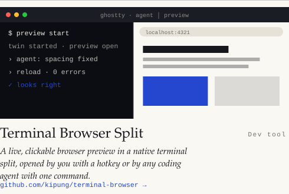</picture></a>

<picture><source media="(max-width: 640px) and (prefers-color-scheme: dark)" srcset="assets/mini-hydro-m-dark.svg"><source media="(max-width: 640px)" srcset="assets/mini-hydro-m-light.svg"><source media="(prefers-color-scheme: dark)" srcset="assets/mini-hydro-dark.svg">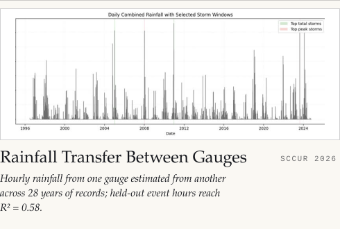</picture>
<a href="https://github.com/kipung/SET_PROJECT_3"><picture><source media="(max-width: 640px) and (prefers-color-scheme: dark)" srcset="assets/mini-acm-m-dark.svg"><source media="(max-width: 640px)" srcset="assets/mini-acm-m-light.svg"><source media="(prefers-color-scheme: dark)" srcset="assets/mini-acm-dark.svg">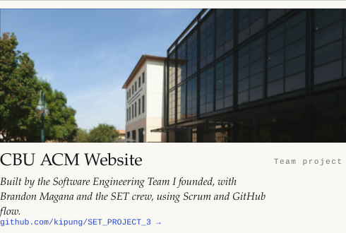</picture></a>

<b>6 more projects</b>

<a href="https://github.com/kipung/tracr_to_transformer_lens_generalize"><picture><source media="(max-width: 640px) and (prefers-color-scheme: dark)" srcset="assets/mini-tracr-m-dark.svg"><source media="(max-width: 640px)" srcset="assets/mini-tracr-m-light.svg"><source media="(prefers-color-scheme: dark)" srcset="assets/mini-tracr-dark.svg">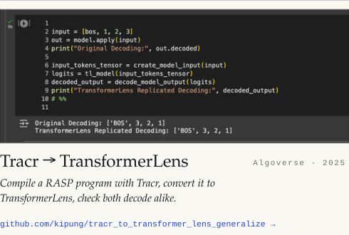</picture></a>
<a href="https://github.com/kipung/ffn_relu_vs_geglu_mnist"><picture><source media="(max-width: 640px) and (prefers-color-scheme: dark)" srcset="assets/mini-geglu-m-dark.svg"><source media="(max-width: 640px)" srcset="assets/mini-geglu-m-light.svg"><source media="(prefers-color-scheme: dark)" srcset="assets/mini-geglu-dark.svg">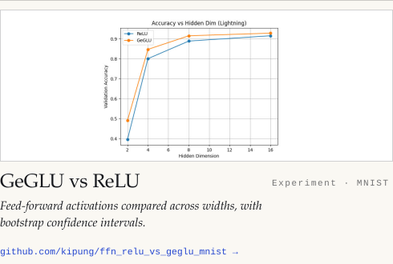</picture></a>

<picture><source media="(max-width: 640px) and (prefers-color-scheme: dark)" srcset="assets/mini-voice-m-dark.svg"><source media="(max-width: 640px)" srcset="assets/mini-voice-m-light.svg"><source media="(prefers-color-scheme: dark)" srcset="assets/mini-voice-dark.svg">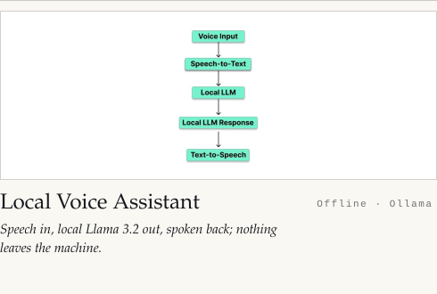</picture>
<a href="https://github.com/kipung/BAY-min_personal_tutor"><picture><source media="(max-width: 640px) and (prefers-color-scheme: dark)" srcset="assets/mini-baymin-m-dark.svg"><source media="(max-width: 640px)" srcset="assets/mini-baymin-m-light.svg"><source media="(prefers-color-scheme: dark)" srcset="assets/mini-baymin-dark.svg">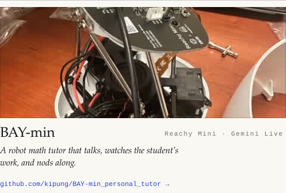</picture></a>

<a href="https://github.com/kipung/campusmate"><picture><source media="(max-width: 640px) and (prefers-color-scheme: dark)" srcset="assets/mini-campusmate-m-dark.svg"><source media="(max-width: 640px)" srcset="assets/mini-campusmate-m-light.svg"><source media="(prefers-color-scheme: dark)" srcset="assets/mini-campusmate-dark.svg">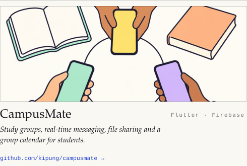</picture></a>
<picture><source media="(max-width: 640px) and (prefers-color-scheme: dark)" srcset="assets/mini-hackathon-m-dark.svg"><source media="(max-width: 640px)" srcset="assets/mini-hackathon-m-light.svg"><source media="(prefers-color-scheme: dark)" srcset="assets/mini-hackathon-dark.svg">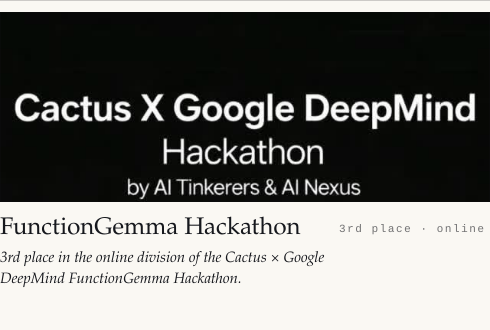</picture>

## In motion

<table>
  <tr>
    <td width="33%"><a href="https://github.com/kipung/living-kanto">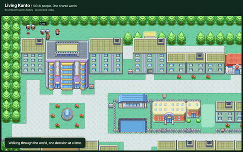</a></td>
    <td width="34%"></td>
    <td width="33%">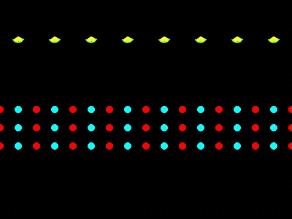</td>
  </tr>
  <tr>
    <td align="center"><b>Living Kanto</b> · 100 local-LLM residents</td>
    <td align="center"><b>Terminal Browser</b> · an agent drives a live page</td>
    <td align="center"><b>Gravitational lensing</b> · physics research</td>
  </tr>
</table>

## Photos

<b>Conferences, competitions, robots and hardware</b>

<picture><source media="(max-width: 640px) and (prefers-color-scheme: dark)" srcset="assets/plate-room-m-dark.svg"><source media="(max-width: 640px)" srcset="assets/plate-room-m-light.svg"><source media="(prefers-color-scheme: dark)" srcset="assets/plate-room-dark.svg">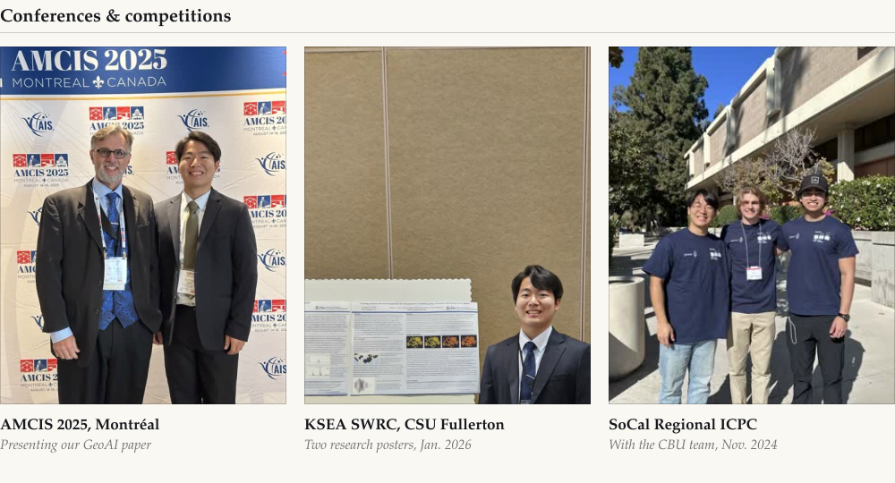</picture>

<picture><source media="(max-width: 640px) and (prefers-color-scheme: dark)" srcset="assets/plate-bench-m-dark.svg"><source media="(max-width: 640px)" srcset="assets/plate-bench-m-light.svg"><source media="(prefers-color-scheme: dark)" srcset="assets/plate-bench-dark.svg">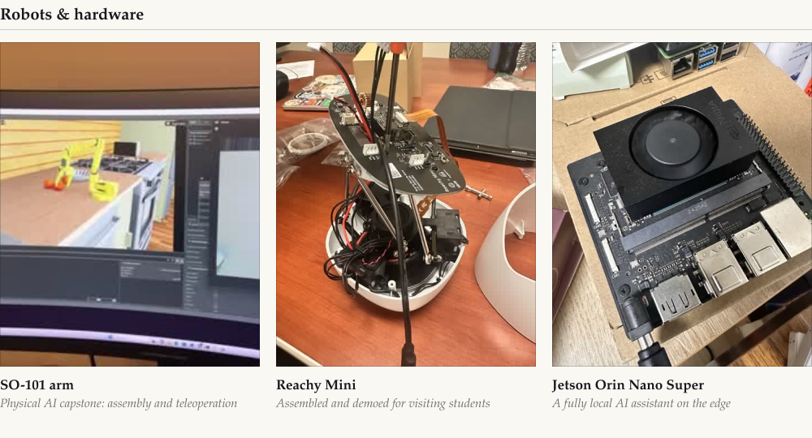</picture>

## Timeline

<picture><source media="(max-width: 640px) and (prefers-color-scheme: dark)" srcset="assets/timeline-m-dark.svg"><source media="(max-width: 640px)" srcset="assets/timeline-m-light.svg"><source media="(prefers-color-scheme: dark)" srcset="assets/timeline-dark.svg">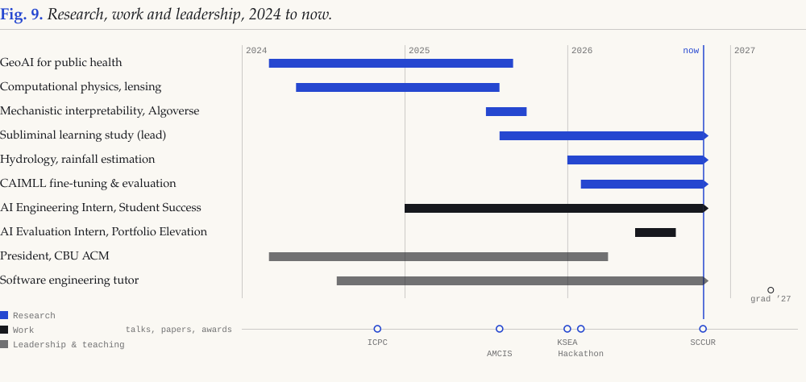</picture>

## Publications & talks

- **Corso, A., Asariah, J. S., Park, K., Corso, N. A., & Lee, E. (2025).** *A DSR Approach for Geospatial AI: Prediction of Drug Overdoses.* AMCIS 2025, Montréal. [Paper](https://aisel.aisnet.org/amcis2025/intelfuture/intelfuture/27/)
- **Park, K., Bergquist, G., Lee, P., & Sanders, B.** *Replicating Subliminal Learning in LLMs via Distillation and LoRA Fine-Tuning.* Under review, *Aletheia: The Alpha Chi Journal of Undergraduate Scholarship*.
- **SCCUR 2026**, San Diego State (Nov. 21): *Towards Modeling Runoff and Flood Prediction over Unreliable Precipitation Gauges* (first author) and *Separate or Unified Fine-Tuning? A Systematic Comparison of Training Strategies for Multi-Document Domain Applications* (second author).
- **KSEA SWRC 2026**, CSU Fullerton: *Subliminal Learning in Large Language Models*; *A Design Science Research Approach for Geospatial AI*.
- **AMCIS 2025**, Montréal: paper presentation.
- 🏆 **3rd place** (online division), Cactus × Google DeepMind FunctionGemma Hackathon.

## Toolbox

<b>ML</b> PyTorch · JAX / Haiku · TransformerLens · Unsloth · LangChain &nbsp;·&nbsp; <b>Methods</b> LoRA / QLoRA · sparse autoencoders · evaluation · synthetic data &nbsp;·&nbsp; <b>Inference</b> Ollama · vLLM · GGUF &nbsp;·&nbsp; <b>Data</b> Neo4j · PostgreSQL · FAISS

## Activity

<picture>
  <source media="(prefers-color-scheme: dark)" srcset="https://raw.githubusercontent.com/kipung/kipung/output/snake-dark.svg">
  
</picture>

Riverside, CA · Interests: LLM architectures, vision-language-action models, physical AI
